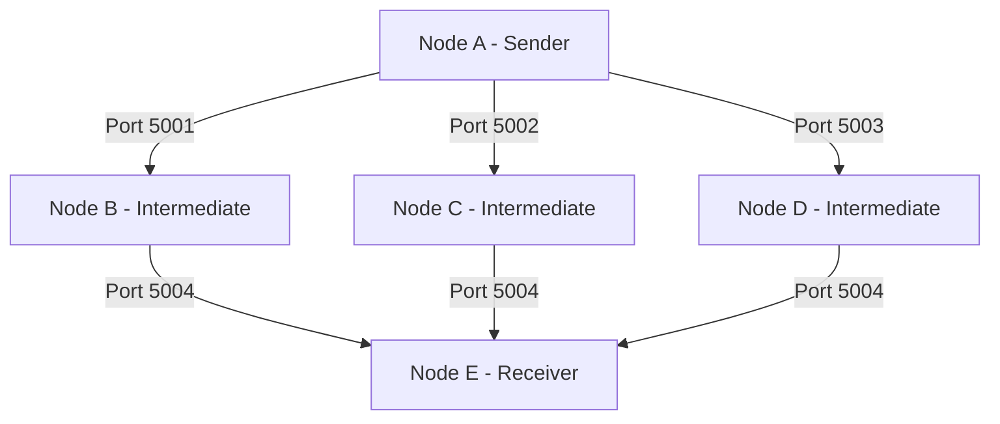
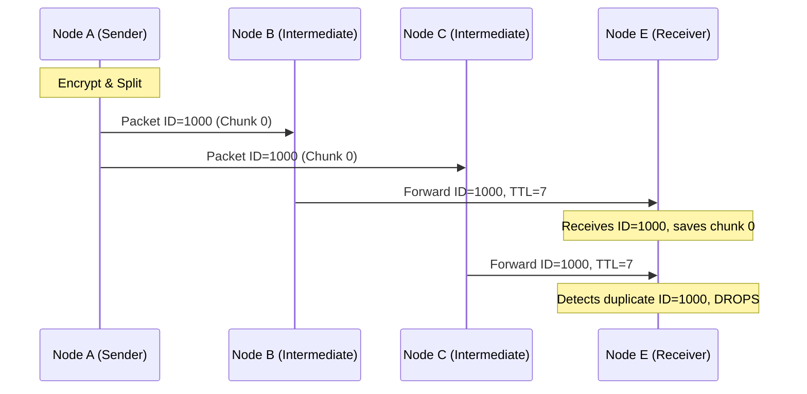

# Design Notes

## Architecture & Topology

The simulation mimics a robust flooding-based broadcast network among 5 logical nodes, connected as follows:

Node A (Sender) reads the image, encryptsw it, chunks it, encapsulates each chunk, and blasts the stream to nodes B, C, and D via individual TCP connections per packet. The intermediates forward everything to E unless the packet duplicates or the Time-To-Live (TTL) is exhausted. Node E aggregates chunks to rebuild the picture. 

## Header Format

Every packet transmitted prepends a 17-byte unencrypted header, strictly packed using network-byte-order `struct`.

| Field            | Type   | Size (bytes) | Notes                                |
|------------------|--------|---------------|---------------------------------------|
| `magic`            | bytes  | 4             | `b"IMGF"` sanity check                |
| `src_id`           | uint8  | 1             | originating node id (A=0)             |
| `dest_id`          | uint8  | 1             | final receiver id (E=4)               |
| `packet_id`        | uint32 | 4             | unique id for this fragment (dedup)   |
| `chunk_sequence`   | uint16 | 2             | order index of this fragment          |
| `total_chunks`     | uint16 | 2             | total fragment count for this image   |
| `ttl`              | uint8  | 1             | decremented at each hop               |
| `payload_length`   | uint16 | 2             | length of the encrypted payload       |

## Sequence Diagram: Flooding & De-duplication

The following sequence illustrates a single fragment's journey from Node A through multiple intermediate nodes to Node E, showcasing how Node E handles duplicate arrivals caused by flooding.

## Evidence & Verification
The integration tests reliably demonstrate the system's operational correctness, verified across 3 consecutive end-to-end runs. The simulated flooding network actively generates deduplication hits while re-assembling and parsing encrypted images perfectly.
