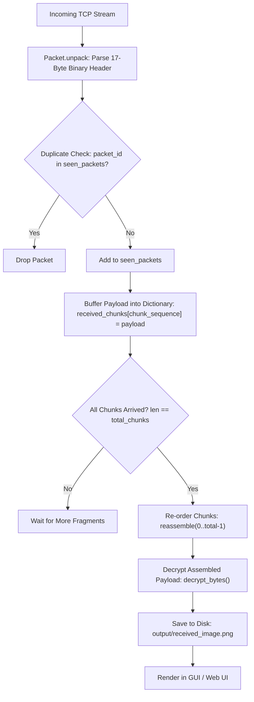

# Receiver Node (Node E) Architecture & Operation Guide

This document explains the internal architecture, network mechanics, and execution pipeline of **Node E (Receiver)** in the ImageCrypt network simulation. It breaks down each step of the process—from packet arrival to image rendering—and details **which file does what and how**.

---

## 1. High-Level Process Overview

Node E serves as the terminal sink for the multi-hop network. Because intermediate nodes (B, C, D) flood packets concurrently, chunks may arrive **out-of-order**, with **variable delays**, or as **redundant duplicates**.

Node E handles this via a 4-step pipeline:



---

## 2. Component & File Mapping: Who Does What

| File | Primary Responsibility | Key Functions / Classes |
| :--- | :--- | :--- |
| [`nodes/receiver_e.py`](./nodes/receiver_e.py) | Receiver service lifecycle, socket handling, packet buffering, and pipeline orchestration | [`ReceiverNode`](./nodes/receiver_e.py), [`process_packet()`](./nodes/receiver_e.py), [`run_receiver()`](./nodes/receiver_e.py) |
| [`common/packet.py`](./common/packet.py) | Custom binary protocol parsing, header deserialization, and payload extraction | [`Packet`](./common/packet.py), [`Packet.unpack()`](./common/packet.py) |
| [`common/fragment.py`](./common/fragment.py) | In-order fragment sequencing, completeness verification, and byte concatenation | [`reassemble()`](./common/fragment.py) |
| [`common/crypto.py`](./common/crypto.py) | Custom decryption algorithm reversing bit manipulation, permutation, and XOR | [`decrypt_bytes()`](./common/crypto.py) |
| [`gui.py`](./gui.py) | Desktop Tkinter UI: monitors receiver output, loads image with Pillow, renders on screen | [`LabNetworkGUI`](./gui.py), [`_start_output_polling()`](./gui.py), [`_render_received_image()`](./gui.py) |
| [`lab_network.py`](./lab_network.py) | Web-based network lab backend: in-memory state tracking, live buffer matrix, and HTTP image serving | [`ReceiverNodeLab`](./lab_network.py), [`_reassemble_and_decrypt()`](./lab_network.py) |
| [`tests/test_receiver.py`](./tests/test_receiver.py) | Automated test suite validating out-of-order handling, duplicate rejection, and image integrity | [`test_receiver_node_reassembly()`](./tests/test_receiver.py) |

---

## 3. Detailed Step-by-Step Walkthrough

### Step 1: Receiving and Unpacking Packets
**File:** [`nodes/receiver_e.py`](./nodes/receiver_e.py) and [`common/packet.py`](./common/packet.py)

1. **Listening on Port**: Node E binds to port `5004` (defined in `NODE_PORTS[4]`) and listens for incoming TCP connections.
2. **Stream Reading**: When an intermediate node forwards a packet, `run_receiver()` reads the byte stream and verifies that it is at least `HEADER_SIZE` (17 bytes).
3. **Header Parsing**: `Packet.unpack(data)` unpacks the custom binary header using `struct.unpack('!4sBBHHHBH', ...)`:
   * `magic` (`b"IMGF"`): Sanity check; raises an exception if the magic bytes mismatch.
   * `packet_id`: Unique 32-bit integer per fragment transmission.
   * `chunk_sequence`: 16-bit integer representing the original ordering index.
   * `total_chunks`: Total number of chunks required for the full image.
   * `payload_length`: Length of the encrypted payload slice.

```python
# common/packet.py
magic, src_id, dest_id, packet_id, chunk_sequence, total_chunks, ttl, payload_length = struct.unpack(
    HEADER_FORMAT, raw_header
)
payload = raw_data[HEADER_SIZE : HEADER_SIZE + payload_length]
```

---

### Step 2: Duplicate Dropping & Indexed Collection
**File:** [`nodes/receiver_e.py`](./nodes/receiver_e.py)

Because nodes B, C, and D all forward packets toward Node E (flooding), Node E will receive multiple identical copies of each fragment.

1. **Duplicate Rejection**:
   ```python
   if pkt.packet_id in self.seen_packets:
       logger.info(f"Dropped duplicate {pkt.header_info}")
       return False
   self.seen_packets.add(pkt.packet_id)
   ```
2. **Collecting into Indexed Dictionary**:
   Node E maintains `self.received_chunks = {}`. The payload is stored directly with its `chunk_sequence` as the key:
   ```python
   self.received_chunks[pkt.chunk_sequence] = pkt.payload
   ```
   * *Why a dictionary instead of a fixed-size list?* Network packets arrive arbitrarily out-of-order. A dictionary functions as a sparse indexed buffer where fragments can be dropped into any index (e.g., chunk 4, then chunk 1, then chunk 0) without requiring pre-allocation or array shifting.

---

### Step 3: In-Order Reassembly
**File:** [`common/fragment.py`](./common/fragment.py)

Once the number of collected unique chunks matches the total expected count (`len(self.received_chunks) == self.total_chunks`), reassembly begins:

```python
def reassemble(fragments: dict[int, bytes], total: int) -> bytes:
    if len(fragments) != total:
        raise ValueError(f"Expected {total} fragments, got {len(fragments)}")
        
    result = bytearray()
    for i in range(total):
        if i not in fragments:
            raise ValueError(f"Missing fragment {i}")
        result.extend(fragments[i])
        
    return bytes(result)
```

* **How chunks are re-ordered**: The function iterates monotonically from index `0` up to `total - 1`. It pulls each payload in strict sequence (`fragments[0]`, `fragments[1]`, ..., `fragments[N-1]`) and concatenates them into a contiguous `bytearray`. Any disorder from network propagation is completely resolved.

---

### Step 4: Decrypting the Assembled Data
**File:** [`common/crypto.py`](./common/crypto.py)

The reassembled byte array represents the complete encrypted image. Node E calls `decrypt_bytes(encrypted_data)`.

The decryption function reverses each stage of the sender's custom cipher in inverse order:
1. **Reverse XOR**: Byte-wise XOR with the shared symmetric key `AES_KEY`:
   $$\text{byte}' = \text{byte} \oplus \text{AES\_KEY}[i \pmod{\text{len}}]$$
2. **Reverse Subtraction**: Adds `MAGIC_NUMBER` (42) modulo 256:
   $$\text{byte}'' = (\text{byte}' + 42) \pmod{256}$$
3. **Reverse Bit Shuffle**: Unshuffles the 8 bits of each byte using the inverse of `BIT_SHUFFLE_KEY = [5, 2, 7, 0, 4, 1, 6, 3]`:
   ```python
   for bit_idx in range(8):
       orig_pos = BIT_SHUFFLE_KEY[bit_idx]
       if (b & (1 << orig_pos)) != 0:
           unshuffled_b |= (1 << bit_idx)
   ```
4. **Reverse Bit Flip**: Flips the bits back to normal using bitwise NOT (`~b & 0xFF`).

The output is the original, raw PNG byte sequence.

---

### Step 5: Saving and Rendering the Image
**Files:** [`nodes/receiver_e.py`](./nodes/receiver_e.py) and [`gui.py`](./gui.py)

1. **Saving to Disk**:
   Node E writes the decrypted bytes to `output/received_image.png`:
   ```python
   out_path = os.path.join(os.path.dirname(__file__), 'output', 'received_image.png')
   with open(out_path, 'wb') as f:
       f.write(decrypted_data)
   ```
2. **State Reset**:
   `self.received_chunks` and `self.total_chunks` are reset to empty/`None` so Node E is ready for the next image transmission, while keeping `seen_packets` intact to prevent delayed network echoes.
3. **Rendering in the GUI**:
   Because `receiver_e.py` runs as a headless backend process, [`gui.py`](./gui.py) monitors the output folder:
   * `_start_output_polling()` polls the filesystem until `output/received_image.png` (or `lab_received_image.png`) is detected.
   * `_render_received_image()` loads the saved image with Pillow (`Image.open(out_path)`), creates a display thumbnail (260×260), renders it on the Tkinter interface (`lbl_img_e`), and verifies byte-exact SHA-256 match.
4. **Rendering in the Web Dashboard (`lab_network.py` + `web/app.js`)**:
   * Saves to `output/lab_received_image.png`.
   * Computes SHA-256 hash to prove byte-for-byte fidelity with the sender's input.
   * Serves the image over HTTP, triggering visual confirmation and the green verification badge in the web UI.

---

## 4. Verification & Testing

The receiver pipeline is verified by [`tests/test_receiver.py`](./tests/test_receiver.py):
* Shuffles fragments into random arrival order.
* Injects duplicate packets.
* Asserts that `ReceiverNode.process_packet()` returns `False` until the very last chunk arrives.
* Confirms that the final written file is byte-for-byte identical to `assets/input_image.png`:
  ```python
  assert received_data == original_data
  ```
